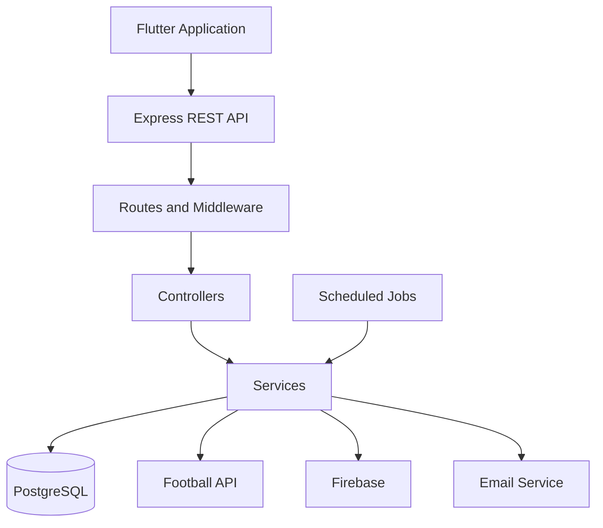

# FootMaster — Backend API

FootMaster is a football application designed to provide match
information, football statistics, personalized notifications,
and Fantasy Football features.

This repository contains the backend REST API developed with
Node.js, Express.js, and PostgreSQL.

## Features

### Football Data
- Football matches and match details
- League standings and competitions
- Team and player information
- Match predictions
- Search functionality
- Time zone management

### User Management
- JWT-based authentication
- Password hashing with bcrypt
- User account management
- Personalized favorites
- User presence management

### Fantasy Football
- Fantasy Football management
- Fantasy data migration

### Notifications
- Notification subscriptions
- Automated notification engine
- Firebase integration
- Administrative notification controls

### Backend Infrastructure
- REST API architecture
- Centralized error handling
- Request rate limiting
- Scheduled cleanup tasks
- Environment-based configuration
- Health monitoring

## Technology Stack

| Category | Technologies |
|---|---|
| Runtime | Node.js |
| Framework | Express.js |
| Language | JavaScript |
| Database | PostgreSQL |
| Authentication | JWT, bcrypt |
| External API | API-Football, RapidAPI, Axios |
| Notifications | Firebase Admin SDK |
| Email | MailerSend |
| Scheduled Tasks | Node-cron |
| Configuration | Dotenv |
| Deployment | Render |
| Version Control | Git, GitHub |

## Project Architecture

The backend follows a layered architecture to separate
HTTP request handling, business logic, middleware,
and external service configuration.

    footmaster-backend/
    ├── src/
    │   ├── config/
    │   ├── controllers/
    │   ├── jobs/
    │   ├── middlewares/
    │   ├── routes/
    │   ├── services/
    │   └── app.js
    ├── .env.example
    ├── .gitignore
    ├── package.json
    ├── package-lock.json
    ├── README.md
    └── server.js

### Architecture Overview



## API Modules

The API is organized into the following route groups.

| Base Route | Description |
|---|---|
| /api/health | Service health monitoring |
| /api/matches | Football matches |
| /api/match | Match details |
| /api/standings | League standings |
| /api/predictions | Match predictions |
| /api/team | Team information |
| /api/player | Player information |
| /api/competitions | Football competitions |
| /api/search | Search functionality |
| /api/timezone | Time zone management |
| /api/auth | Authentication |
| /api/account | Account management |
| /api/favorites | User favorites |
| /api/fantasy | Fantasy Football |
| /api/fantasy-migration | Fantasy data migration |
| /api/notifications/subscriptions | Notification subscriptions |
| /api/notification-engine | Notification engine |
| /api/notification-engine-admin | Notification administration |
| /api/user-presence | User presence |

## Getting Started

### Prerequisites

- Node.js and npm
- PostgreSQL database
- Football API credentials
- Firebase service account credentials
- Email service credentials

### Installation

Clone the repository:

```bash
git clone https://github.com/axelorphee/footmaster-backend.git
cd footmaster-backend
```

Install dependencies:

```bash
npm ci
```

Create a `.env` file using `.env.example` as a template.

Configure the required environment variables and prepare
the PostgreSQL database before starting the server.

For Firebase, provide either the service account JSON
through the environment variable or a local service account
file in `src/config/`.

### Start the Server

```bash
npm start
```

The default local server address is:

    http://localhost:5000

### Environment Variables

| Variable | Description |
|---|---|
| PORT | HTTP server port |
| DATABASE_URL | PostgreSQL connection string |
| JWT_SECRET | JWT signing secret |
| APP_ADMIN_BOOTSTRAP_CODE | Administrator initialization code |
| RAPIDAPI_KEY | Football API access key |
| RAPIDAPI_HOST | Football API host |
| FIREBASE_SERVICE_ACCOUNT_JSON | Firebase service account credentials |
| MAILERSEND_API_KEY | Email service API key |

Never commit real credentials or private keys to the repository.

## Deployment

The backend is deployed on Render.

## Security and Maintenance

The project implements environment-based secret management,
JWT authentication, password hashing, and API rate limiting.

Dependency auditing and further security improvements
are part of ongoing maintenance.

## Project Status

The backend is operational and under continued development.

Database initialization scripts, detailed endpoint documentation,
and additional automated tests are planned for future improvements.

## Author

Orphée Axel Oladjouhon BADA

- Software Engineering Graduate
- Computer Science Student at Université Clermont Auvergne
- GitHub: [axelorphee](https://github.com/axelorphee)
